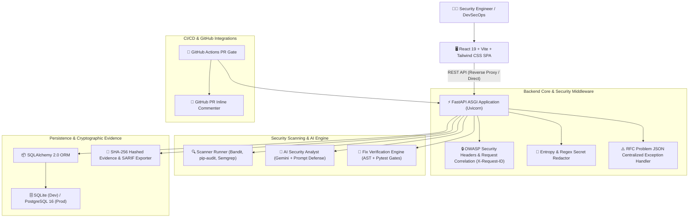

<div align="center">

# 🛡️ Red Mercury

### Enterprise Application Security & Automated Fix Verification Engine

[](https://www.python.org/)
[](https://fastapi.tiangolo.com/)
[](https://react.dev/)
[](https://www.typescriptlang.org/)
[](https://tailwindcss.com/)
[](https://www.docker.com/)
[](#)

<p align="center">
  <b>Red Mercury</b> is an enterprise DevSecOps platform that unifies multi-engine static and dependency vulnerability detection with <b>AST taint trace analysis</b>, <b>prompt-injection-defended AI remediation</b>, and <b>cryptographically verified fix verification gates</b>.
</p>

[Key Features](#-key-features) •
[Architecture](#-architecture--data-flow) •
[Quick Start](#-quick-start) •
[Docker Deployment](#-docker-production-deployment) •
[CI/CD Integration](#-cicd-pr-security-gate) •
[Documentation](#-documentation-index)

---

</div>

## 📌 Executive Overview

Modern vulnerability scanners generate overwhelming noise and false positives, while naive LLM fix generators frequently introduce subtle regressions and syntax errors. **Red Mercury** bridges this gap:

1. **Multi-Scanner Orchestration**: Aggregates and normalizes alerts across **Bandit** (Python SAST), **pip-audit** (SCA), **Semgrep** (Polyglot SAST), and external secret scanning tools (**Gitleaks**).
2. **Contextual Risk Prioritization**: Computes real-world risk scores using CVSS v3.1, EPSS exploitability probabilities, reachability flags, and asset criticality.
3. **AI Security Analyst with Guardrails**: Leverages Gemini 2.5 Flash to synthesize plain-language root cause explanations, bounded diff patches, and regression test suites behind strict prompt-injection defenses and secret redaction engines.
4. **Automated Fix Verification Gates**: Validates proposed code fixes via differential scanner re-execution, compiler and syntax checks, and sandboxed test execution before any patch merges.
5. **Cryptographic Evidence Lifecycle**: Generates immutable, SHA-256 hashed audit records and exportable compliance reports in **SARIF 2.1.0**, **JSON**, and **Markdown**.

---

## 🚀 Key Features

```
┌────────────────────────────────────────────────────────────────────────────────────────┐
│                                   RED MERCURY CORE                                     │
├─────────────────────┬──────────────────────┬────────────────────┬──────────────────────┤
│ 🔍 Multi-Scanner    │ 🧠 AI Security       │ 🧪 Automated Fix   │ 📜 Evidence          │
│    Orchestration    │    Analyst Engine    │    Verification    │    Lifecycle         │
│ • Bandit SAST       │ • Gemini 2.5 Flash   │ • Ephemeral Gates  │ • SHA-256 Hashing    │
│ • Semgrep Polyglot  │ • Prompt Injection   │ • AST Taint Trace  │ • Tamper Detection   │
│ • pip-audit SCA     │   Guardrails         │ • Differential     │ • SARIF 2.1.0 Export │
│ • Entropy Redactor  │ • Deterministic      │   Re-Scanning      │ • Full Audit Trail   │
│ • Gitleaks Secrets  │   Fallbacks          │ • Unit Test Replay │ • Tenant Isolation   │
└─────────────────────┴──────────────────────┴────────────────────┴──────────────────────┘
```

### 1. Unified Security Scanning & Secret Redaction
- Modular scanner adapter architecture (`BaseScannerAdapter`).
- Subprocess safety with strict timeouts (`timeout_seconds=60`), structured output parsing, and zero shell evaluation (`shell=True` strictly prohibited).
- High-entropy secret scrubbing (AWS keys, GitHub PATs, JWTs, Bearer headers, database URLs) before data ever touches persistent storage or external LLMs.

### 2. Contextual Risk Prioritization Model
- Dynamic priority scoring based on **EPSS exploitability**, **CWE impact**, and **reachable AST paths**.
- Noise reduction filters to deduplicate findings across scanning tools.
- SLA tracking with automated severity escalations (`CRITICAL`, `HIGH`, `MEDIUM`, `LOW`).

### 3. AI Security Analyst (Secure LLM Pipeline)
- Context-bounded retrieval: Clamps surrounding code snippets to strictly required scopes (+/- 15 lines).
- Prompt-injection defenses: Isolates untrusted repository files, commits, and comments into `<untrusted_source_code>` blocks.
- Deterministic AppSec fallback engine ensuring 100% availability during network timeouts or offline mode.

### 4. Automated Fix Verification Gates
- Executes automated pre-patch vs. post-patch verification cycles.
- Compares AST taint paths to confirm vulnerability mitigation without code regressions.
- Ephemeral test runner executes test suites and linters against proposed patches.

### 5. Enterprise GitHub PR Gate & CI/CD Reviewer
- Headless Python runner (`scripts/ci_security_gate.py`) and GitHub Action workflow (`.github/workflows/redmercury_pr_gate.yml`).
- Automatically comments inline security findings and fix suggestions onto GitHub Pull Requests.
- Configurable quality gates (`fail_on: high_or_critical` or custom threshold limits).

---

## 🏗️ Architecture & Data Flow



---

## 💻 Technology Stack

| Layer | Technologies | Description |
|---|---|---|
| **Frontend** | React 19, TypeScript 5.7, Vite 6, Tailwind CSS v4 | Ultra-responsive, glassmorphic security workbench with real-time finding triaging |
| **Backend** | Python 3.11+, FastAPI, Pydantic v2, SQLAlchemy 2.0 | Asynchronous REST backend with strict typing, correlation IDs, and OpenAPI specs |
| **Database** | SQLite 3 (Dev), PostgreSQL 16 (Production) | Managed schema migrations via Alembic |
| **AI Layer** | Google Gemini 2.5 Flash + Fallback Ruleset Engine | Structured remediation generation with prompt injection isolation |
| **Security Engines** | Bandit, pip-audit, Semgrep, Gitleaks | Normalized multi-vendor SAST, SCA, and Secret scanning |
| **Testing** | Pytest 8+, Vitest, React Testing Library | Full unit, schema, database, and end-to-end integration test coverage |
| **Infrastructure** | Docker, Docker Compose, Nginx, Linux non-root | Hardened multi-stage container images for enterprise staging & production |

---

## 📁 Repository Structure

```text
Red Mercury-AI/
├── backend/                       # FastAPI Backend Application
│   ├── alembic/                   # Database schema migration revisions
│   ├── app/
│   │   ├── analyzer/              # AST parsing & taint flow tracking
│   │   ├── api/v1/                # Versioned REST API endpoints
│   │   ├── core/                  # Configuration, logging, security & errors
│   │   ├── db/                    # SQLAlchemy engine & session lifecycles
│   │   ├── evidence/              # SHA-256 evidence hashing & lifecycle manager
│   │   ├── integrations/          # GitHub App & Webhook handlers
│   │   ├── models/                # ORM domain models (Repository, Finding, Evidence, Verification)
│   │   ├── prioritization/        # Contextual risk & EPSS calculation
│   │   ├── scanner/               # Scanner adapter suite (Bandit, pip-audit, Semgrep, Gitleaks)
│   │   ├── schemas/               # Pydantic v2 request/response schemas
│   │   ├── validation/            # Vulnerability validation routines
│   │   ├── verification/          # Fix verification sandbox engine
│   │   └── main.py                # Application entrypoint & middleware stack
│   ├── requirements.txt           # Python dependencies
│   └── pyproject.toml             # Pytest & tool configurations
├── frontend/                      # React 19 Frontend Application
│   ├── src/
│   │   ├── components/            # UI Components (Dashboard, Findings, Analyzer, Evidence Modal)
│   │   ├── context/               # React application state providers
│   │   ├── pages/                 # Route views (Repositories, Findings, Verification, Settings)
│   │   ├── services/              # Axios/Fetch API client layer
│   │   ├── App.tsx                # Routing & top-level layout
│   │   └── main.tsx               # DOM bootstrap
│   ├── package.json               # Frontend dependencies & scripts
│   └── vite.config.ts             # Vite build & backend proxy config
├── docs/                          # In-Depth Engineering & Security Documentation
│   ├── AI_ANALYST.md              # AI remediation architecture & prompt defenses
│   ├── ARCHITECTURE.md            # Detailed system design & component diagrams
│   ├── EVIDENCE_LIFECYCLE.md      # Cryptographic evidence standard & audit specs
│   ├── SCANNERS.md                # Scanner adapters, CWE mapping & constraints
│   ├── VERIFICATION.md            # Fix verification & AST taint trace pipeline
│   └── PRODUCTION_DEPLOYMENT_GUIDE.md # Enterprise hardening & deployment guide
├── scripts/                       # Automation & Quality Gate Scripts
│   ├── ci_security_gate.py        # Standalone CI/CD PR blocking gate
│   ├── setup.ps1                  # One-click Windows PowerShell development setup
│   ├── run_backend.ps1            # Start FastAPI development server
│   ├── run_frontend.ps1           # Start Vite frontend dev server
│   └── run_tests.ps1              # Run both Pytest and Vitest test suites
├── docker-compose.prod.yml        # Production Docker Compose orchestration
├── Dockerfile.api                 # Non-root hardened FastAPI image
├── Dockerfile.frontend            # Multi-stage Nginx React bundle image
├── .env.example                   # Safe template for environment configuration
└── README.md                      # Project documentation
```

---

## ⚡ Quick Start

### Prerequisites
- **Python 3.11+** (Python 3.11 – 3.14 supported)
- **Node.js 20+** and **npm**
- **Git**

### Option 1: Native Windows Desktop Software (Recommended)

Run Red Mercury directly as a standalone desktop software application:

```cmd
# Double-click or run from command prompt:
.\Launch-Red-Mercury-Desktop.bat
```

Or run via npm:
```powershell
npm run desktop          # Launch native desktop application
npm run desktop:dev      # Launch desktop application with live reload
npm run desktop:dist     # Generate Windows NSIS installer (.exe)
npm run desktop:portable # Generate portable standalone executable (.exe)
```

---

### Option 2: Automated PowerShell Bootstrap

#### 1. Configure Environment Variables
```bash
# Windows PowerShell:
Copy-Item .env.example .env

# Linux / macOS:
cp .env.example .env
```
*(Optional: Provide a `GEMINI_API_KEY` in `.env` to enable online LLM remediation suggestions. If left blank, Red Mercury seamlessly uses the built-in deterministic AppSec remediation engine).*

#### 2. Setup & Launch Backend
```bash
# Create and activate virtual environment (optional but recommended)
python -m venv .venv
# Windows:
.venv\Scripts\Activate.ps1
# Linux / macOS:
source .venv/bin/activate

# Install dependencies
pip install -r backend/requirements.txt

# Run database migrations
python -m alembic -c backend/alembic.ini upgrade head

# Start FastAPI development server
# Windows PowerShell:
$env:PYTHONPATH="backend"
python -m uvicorn app.main:app --host 127.0.0.1 --port 8000 --reload

# Linux / macOS:
PYTHONPATH=backend uvicorn app.main:app --host 127.0.0.1 --port 8000 --reload
```

- **API Base**: `http://127.0.0.1:8000`
- **Swagger Interactive Docs**: `http://127.0.0.1:8000/docs`
- **ReDoc Specification**: `http://127.0.0.1:8000/redoc`
- **Health Check**: `http://127.0.0.1:8000/api/v1/health`

#### 3. Setup & Launch Frontend
In a second terminal window:

```bash
cd frontend
npm install
npm run dev
```

- **Frontend Application**: `http://localhost:3000`
- Requests to `/api/*` are automatically proxied to the backend on `http://127.0.0.1:8000`.

---

## 🐳 Docker Production Deployment

Red Mercury includes hardened, unprivileged multi-stage Docker builds configured for containerized production environments.

```bash
# 1. Copy production environment file
cp .env.production.example .env.production

# 2. Build and launch all services in detached mode
docker compose -f docker-compose.prod.yml --env-file .env.production up -d --build

# 3. Verify container health status
docker compose -f docker-compose.prod.yml ps
```

The stack provisions:
- **`redmercury_postgres`**: PostgreSQL 16 database with dedicated health checks.
- **`redmercury_api`**: Hardened FastAPI container running under unprivileged user `appuser`.
- **`redmercury_worker`**: Standalone asynchronous security scanner and background task processing daemon.
- **`redmercury_frontend`**: Nginx Alpine serving the pre-rendered React 19 production build and SSL termination.

---

### 🛡️ Asynchronous Security Scan Architecture

Red Mercury decouples multi-tool scan execution from HTTP request lifecycles to prevent reverse-proxy timeouts (`504 Gateway Timeout`) on large workspaces:

1. **Submit Scan (`POST /api/v1/scans`)**: Returns `HTTP 202 Accepted` with initial status `"queued"` and enqueues execution via FastAPI `BackgroundTasks` (or persistent worker queue). To run synchronously for deterministic integration tests, supply `?sync=true` (returning `HTTP 201 Created`).
2. **Poll Status (`GET /api/v1/scans/{scan_id}/status`)**: Returns lightweight real-time progress:
   ```json
   {
     "id": "381d4a78-aa7b-4408-b4c6-de12a8b57441",
     "repository_id": "6be2f284-bc06-45f3-beb4-d0ddc1fb39b1",
     "status": "completed",
     "is_complete": true,
     "started_at": "2026-10-19T08:42:27Z",
     "completed_at": "2026-10-19T08:42:28Z",
     "execution_time_seconds": 1.25,
     "total_findings": 2
   }
   ```
3. **Fetch Normalized Results (`GET /api/v1/scans/{scan_id}/results`)**: Delivers complete findings catalog with evidence hashes, scanner breakdowns, and health metrics.
4. **Security & Resiliency**: Enforces strict repository-level multi-tenant authorization (403 on foreign scans), bounded concurrency quotas, and automatic stale job reconciliation (`reconcile_interrupted_jobs`).

---

## 🚦 CI/CD PR Security Gate

Red Mercury can enforce compliance gates on every Pull Request via GitHub Actions:

```yaml
# .github/workflows/redmercury_pr_gate.yml
name: Red Mercury Security Gate

on:
  pull_request:
    branches: [ main, master, develop ]

jobs:
  security-gate:
    runs-on: ubuntu-latest
    steps:
      - name: Check out repository
        uses: actions/checkout@v4

      - name: Set up Python
        uses: actions/setup-python@v5
        with:
          python-version: '3.11'

      - name: Run Red Mercury Security Gate
        env:
          GITHUB_TOKEN: ${{ secrets.GITHUB_TOKEN }}
        run: |
          pip install -r backend/requirements.txt
          python scripts/ci_security_gate.py \
            --repo-path . \
            --fail-on HIGH \
            --format sarif \
            --output-file redmercury-report.sarif
```

#### CLI Arguments & Supported Aliases

| Flag | Alias | Description | Supported Values |
|---|---|---|---|
| `--repo-path` | `--workspace` | Target repository workspace path | File path (e.g. `.`) |
| `--fail-on` | — | Severity threshold to fail the gate | `CRITICAL`, `HIGH` (or `high_or_critical`), `MEDIUM`, `LOW` |
| `--format` | — | Report output format | `json`, `sarif`, `markdown`, `text` |
| `--output-file` | `--output-report` | Output file destination | File path (e.g. `redmercury-report.sarif`) |
| `--strict-checks` | `--no-strict-checks` | Gate failure behavior when checks are unavailable | Default: `strict` (fails gate if configured tools are missing) |

#### Exit Codes
- `0`: **PASS** — Zero policy violations; all checks passed.
- `1`: **FAIL** — Gate failed; new or regressed findings exceed policy threshold.
- `2`: **INCOMPLETE / ERROR** — Configured security checks missing under strict mode, or invalid CLI arguments.

---

## 🧪 Running Automated Tests

Red Mercury maintains rigorous test suites covering API contracts, model persistence, scanner parsers, error envelopes, and UI components.

```bash
# Run both Backend & Frontend tests via PowerShell script:
.\scripts\run_tests.ps1

# Run Backend Pytest suite:
python -m pytest tests/ -v

# Run Backend test coverage:
python -m pytest tests/ --cov=backend/app --cov-report=term-missing

# Run Frontend Vitest suite:
npm --prefix frontend run test
```

---

## ⚙️ Configuration Reference

Key configuration options configurable via `.env`:

| Variable | Default | Description |
|---|---|---|
| `APP_NAME` | `Red Mercury` | Name of the platform instance |
| `APP_ENV` | `development` | Deployment environment (`development`, `staging`, `production`) |
| `DATABASE_URL` | `sqlite:///./redmercury.db` | SQLAlchemy database connection URI |
| `SECRET_KEY` | *(Set in prod)* | Cryptographic key for session cookies and token signing |
| `CORS_ORIGINS` | `["http://localhost:3000"]` | Allowed CORS origins for frontend integration |
| `GEMINI_API_KEY` | *(None)* | Google Gemini API key for AI security analyst remediation |
| `GEMINI_MODEL` | `gemini-2.5-flash` | Gemini model tag used for advisory analysis |
| `AI_TIMEOUT_SECONDS` | `15` | Maximum duration before fallback ruleset engages |
| `LOG_LEVEL` | `INFO` | Logging verbosity (`DEBUG`, `INFO`, `WARNING`, `ERROR`) |
| `LOG_FORMAT_JSON` | `False` | Structured JSON log outputs for Datadog / CloudWatch |

---

## 🔒 Security & Privacy Invariants

- **Zero Hardcoded Secrets**: Credentials, access tokens, and private keys are never stored in source code.
- **Strict Data Scrubbing**: Before analysis or persistence, code excerpts pass through regex-based entropy filters.
- **Prompt-Injection Sandboxing**: Untrusted source code files and commit descriptions are quarantined from LLM system directives.
- **RFC Problem Details**: Errors follow standardized `application/problem+json` envelopes accompanied by an auditable `X-Request-ID`.
- **Non-Authoritative AI Output**: AI remediation suggestions are strictly advisory and require validation through automated verification test gates before merging.

---

## 📚 Documentation & Reports Index

Explore the complete technical specifications in the [`docs/`](docs/) directory and historical security audits in [`reports/`](reports/):

- 📐 [Architecture & System Design](docs/ARCHITECTURE.md)
- 🔌 [REST API Specifications & Schema](docs/API.md)
- 🤖 [AI Security Analyst Guide](docs/AI_ANALYST.md)
- 🔏 [Security Evidence Lifecycle Specification](docs/EVIDENCE_LIFECYCLE.md)
- 🔍 [Security Scanners & CWE Mapping](docs/SCANNERS.md)
- 🧪 [Fix Verification Engine](docs/VERIFICATION.md)
- ⚖️ [Vulnerability Prioritization Model](docs/VULNERABILITY_PRIORITIZATION_MODEL.md)
- 🚀 [Production Deployment & Hardening Guide](docs/PRODUCTION_DEPLOYMENT_GUIDE.md)
- 🛡️ [Security Policy & Disclosures](docs/SECURITY.md)
- 📊 [Security Audit & Verification Reports](reports/README.md)

---

## 📂 Repository Layout

```
Red-Mercury/
├── backend/                     # Python 3.11+ FastAPI application core
│   ├── app/
│   │   ├── analyzer/            # AI Security Analyst, prompt guardrails & fallback engine
│   │   ├── api/v1/endpoints/    # REST API route controllers
│   │   ├── core/                # Auth, JWT, rate-limiting, config & security headers
│   │   ├── db/                  # SQLAlchemy session & Base model definitions
│   │   ├── evidence/            # Cryptographic evidence & tamper detection
│   │   ├── integrations/        # GitHub App, webhooks & PR analyzer
│   │   ├── models/              # Domain ORM entities (Findings, Users, Scans, etc.)
│   │   ├── prioritization/      # Multi-factor risk scoring (EPSS + CVSS + reachability)
│   │   ├── scanner/             # Multi-scanner engine (Bandit, pip-audit, Gitleaks, etc.)
│   │   ├── schemas/             # Pydantic v2 request/response schemas
│   │   ├── validation/          # Vulnerability false-positive validation rules
│   │   └── verification/        # Sandbox runner, patch applier & regression analyzer
│   └── alembic/                 # Database schema migrations
├── frontend/                    # React 19 + TypeScript + Vite + Tailwind CSS SPA
│   └── src/
│       ├── components/          # Reusable UI cards, modals, layout, and badges
│       ├── context/             # Global AuthContext & state management
│       ├── pages/               # Routed views (Dashboard, Findings, Repositories, etc.)
│       └── services/            # Typed Axios API client & error handling
├── benchmark/                   # Fix-verification benchmark framework & dataset
├── docs/                        # Complete technical architecture & engineering specifications
├── reports/                     # Security audit reports, health checks & phase reviews
├── scripts/                     # Developer automation, CI security gate & deployment helpers
└── tests/                       # Pytest test suite (unit, integration & adversarial security)
```

---

## 🤝 Contributing & License

Contributions are welcome! Please follow our established development practices:
1. Fork the repository and create a descriptive feature branch (`feature/my-enhancement`).
2. Verify all backend and frontend tests pass (`npm run test` or `.\scripts\run_tests.ps1`).
3. Submit a Pull Request targeting `main`.

Developed and maintained by **Xerova Digital Solutions**.  
Licensed under the Apache 2.0 / Proprietary Dual License. See [LICENSE](LICENSE) for details.